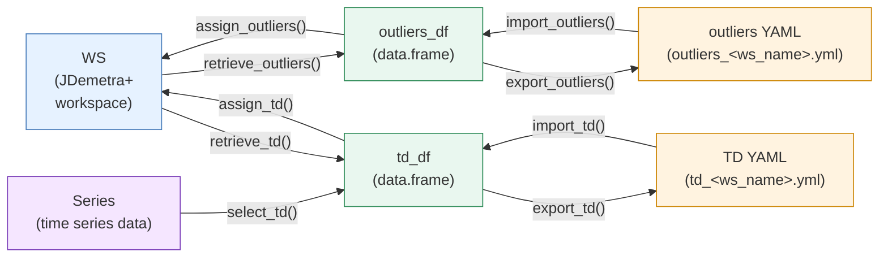

<!-- README.md is generated from README.Rmd. Please edit that file -->

# {rjd3production}

<!-- badges: start -->

[](https://CRAN.R-project.org/package=rjd3production)

[](https://github.com/InseeFr/rjd3production/actions/workflows/R-CMD-check.yml)
[](https://github.com/InseeFr/rjd3production/actions/workflows/lint.yml)
[](https://github.com/InseeFr/rjd3production/actions/workflows/pkgdown.yml)
[](https://app.codecov.io/gh/InseeFr/rjd3production)
<!-- badges: end -->

<div data-align="center">

## [🇫🇷 README en français](#présentation) \| [🇬🇧 README in english](#overview)

</div>

### Présentation

**{rjd3production}** aide les producteurs de données CVS-CJO à mettre en
place des chaînes de production.

Il permet notamment de :

- Créer un calendrier français et des régresseurs de calendrier
  compatibles avec JDemetra+

- Identifier des SAI par leur nom

- Selectionner les jeux de calendrier pour une ou plusieurs séries

- Manipuler les régresseurs de calendrier et les outliers d’un Workspace
  selon la dynamique suivante:

  - Les fonctions `import_XXX()` et `export_XXX()` permettent de
    convertir les data.frame contenant les outliers et régresseurs de
    calendrier en fichiers et inversement

  - Les fonctions `retrieve_XXX()` et `assign_XXX()` permettent
    d’extraire (resp. d’assigner) les outliers et régresseurs de
    calendrier d’un workspace



## Installation

**{rjd3production}** s’appuie sur le package
[**{rJava}**](https://CRAN.R-project.org/package=rJava)

L’exécution des packages rjd3 nécessite **Java 21 ou plus**. La manière
de mettre en place une telle configuration dans R est expliquée
[ici](https://doc.jdemetra.org/#Rconfig).

### Latest release

Pour obtenir la version stable actuelle (à partir de la dernière
version) :

- Depuis GitHub :

``` r
# install.packages("remotes")
remotes::install_github("InseeFr/rjd3production@*release")
```

- De
  [r-universe](https://TanguyBarthelemy.r-universe.dev/rjd3production) :

``` r
install.packages("rjd3production", repos = c("https://TanguyBarthelemy.r-universe.dev", "https://cloud.r-project.org"))
```

### Version de développement

Vous pouvez installer la version de développement de
**{rjd3production}** depuis \[GitHub\] (<https://github.com/>) avec :

``` r
# install.packages("remotes")
remotes::install_github("InseeFr/rjd3production")
```

<!-- ### Usage -->

<!-- #### Chargement du package -->

<!-- ```{r fr-loading-rjd3production, eval = TRUE} -->

<!-- library("rjd3production") -->

<!-- ``` -->

### Overview

**{rjd3production}** help setting up a production process of seasonally
adjusted (SA) data.

In particular, it allows to:

- Create JDemetra+-compatible (French) calendars and calendar regressors

- Identify SA-items by name

- Select calendar sets for one or more series

- Wrangle calendar regressors and outliers in a workspace with the
  following dynamics:

  - The `import_XXX()` and `export_XXX()` functions convert data.frames
    containing calendar outliers and regressors into files, and vice
    versa.
  - The `retrieve_XXX()` and `assign_XXX()` functions extract (resp.
    assign) calendar outliers and regressors from a workspace.


### Installation

**{rjd3production}** relies on the
[**{rJava}**](https://CRAN.R-project.org/package=rJava) package

Running rjd3 packages requires **Java 21 or higher**. Instructions on
how to set up this configuration in R are available
[here](https://doc.jdemetra.org/#Rconfig).

To get the current stable version (from the latest release):

- From GitHub:

``` r
# install.packages("remotes")
remotes::install_github("InseeFr/rjd3production@*release")
```

- From
  [r-universe](https://TanguyBarthelemy.r-universe.dev/rjd3production):

``` r
install.packages("rjd3production", repos = c("https://TanguyBarthelemy.r-universe.dev", "https://cloud.r-project.org"))
```

### Development version

You can install the development version of **{rjd3production}** from
[GitHub](https://github.com/) with:

``` r
# install.packages("remotes")
remotes::install_github("InseeFr/rjd3production")
```

<!-- ### Usage -->

<!-- #### Loading the package -->

<!-- ```{r en-loading-rjd3production, eval = TRUE} -->

<!-- library("rjd3production") -->

<!-- ``` -->
